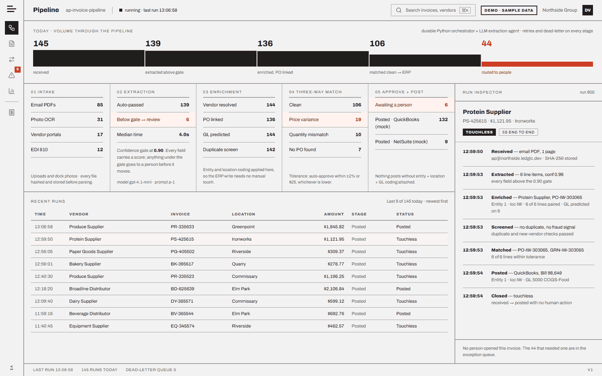
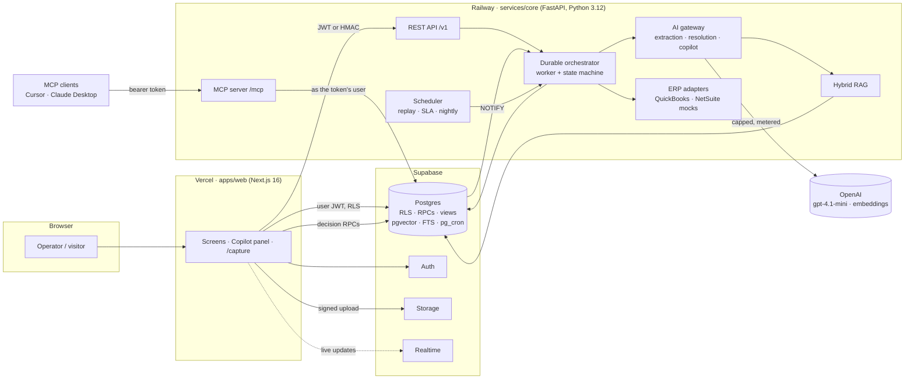
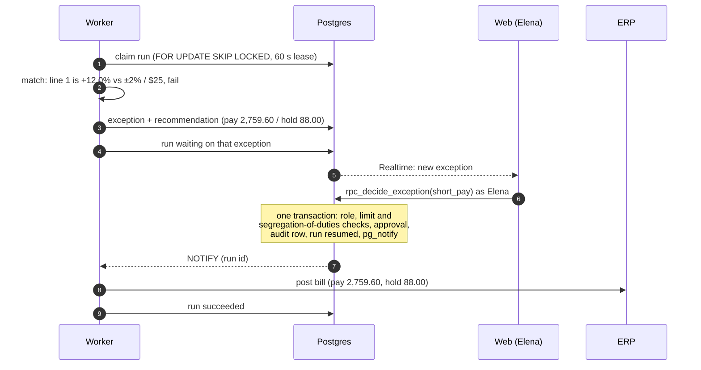

<p align="center">
  
</p>

<h1 align="center">Ledgic: open-source AI accounts payable automation</h1>

<p align="center">
  <b>Invoice processing with AI agents, RAG and an MCP server.</b><br>
  Reads supplier invoices, runs a three-way match against the purchase order, the goods receipt and the contract,<br>
  and posts clean bills to the ERP with no human touch. Everything else goes to a person, with the evidence attached.
</p>

<p align="center">
  <a href="https://ledgic-pearl.vercel.app"><b>Live demo</b></a> ·
  <a href="#how-ledgic-works">How it works</a> ·
  <a href="#ai-agents-rag-and-mcp">Agents, RAG and MCP</a> ·
  <a href="#run-ledgic-locally">Run locally</a> ·
  <a href="docs/ARCHITECTURE.md">Architecture</a>
</p>

<p align="center">
  <a href="https://github.com/alihdrndm/ledgic/actions/workflows/ci.yml"></a>
  <a href="https://github.com/alihdrndm/ledgic/actions/workflows/codeql.yml"></a>
  <a href="https://scorecard.dev/viewer/?uri=github.com/alihdrndm/ledgic"></a>
  <a href="LICENSE"></a>
  
  
  
  
</p>

<p align="center">
  
</p>

---

A shrimp supplier bills **$4.12 a pound**. The contract on file says **$3.68**. On a 200 lb order that is $88 nobody agreed to pay, hidden on line 1 of a five-line invoice.

Ledgic catches it in under a second. It reads the PDF, finds clause 4.2 of the supplier agreement, sees the goods arrived in full, and recommends paying **$2,759.60** and holding **$88.00**. An AP manager clicks once. The bill posts to the ERP and the decision lands in a tamper-evident audit log.

That is the whole product in one invoice: **accounts payable automation where AI reads the documents and deterministic code decides the money.**

## What is Ledgic?

Ledgic is an open-source **AP automation** platform. It turns a supplier invoice into a posted, coded, audited bill, and it only asks a human when something is actually wrong.

**Accounts payable** (AP) is the team that pays a company's suppliers. Their core control is the **three-way match**: before paying, check that the invoice agrees with the **purchase order** (what you ordered) and the **goods receipt** (what actually arrived). Ledgic adds a fourth leg, the **contract price**, because that is where overbilling hides.

It runs live on a fictional customer, Northside Restaurant Group: 3 legal entities, 34 restaurants, around 180 invoices a day. Every number on every screen is a SQL query over real pipeline runs. Nothing is mocked in the UI.

## Try the live demo in 30 seconds

Open **[ledgic-pearl.vercel.app](https://ledgic-pearl.vercel.app)** and pick a door. No email or sign-up needed.

| Button | You become | What you can do |
|---|---|---|
| **Open the demo** | Demo Viewer, read-only | Browse every screen, open any invoice, verify the audit chain, ask the copilot |
| **Try as Elena (AP manager)** | Elena Marsh, approves up to $5,000 | Confirm extracted fields, short-pay PS-88214, watch the paused run resume and post |

The demo replays a full business day on a schedule (America/New_York) and resets every night, so you can't break it.

## How Ledgic works

An invoice moves through seven stages. Each one is a step in a **durable workflow**, which means its progress is saved in the database, so a crash or a deploy never loses an invoice halfway.

1. **Intake.** Upload a PDF or use mobile `/capture` to submit a photo. Email, vendor portal and EDI rows in the demo are replayed documents, not live integrations. Uploaded files are SHA-256 hashed, so a supplier who sends the same invoice twice never creates a second payment.
2. **AI invoice extraction.** A vision model reads the document into a strict schema: header fields and every line item, each with a **confidence score** and the box on the page where it found it. A confidence gate (document 0.90, every field 0.75) decides whether a person must look.
3. **Enrichment.** Fuzzy vendor matching with aliases, purchase order linking, GL coding per line (nearest neighbours over past coded invoices), legal entity and location.
4. **Duplicate and fraud screening.** Invoice-number similarity, amount and date, line overlap and a perceptual image hash catch duplicates. Bank details that differ from the W-9, a brand-new vendor, no PO and a changed remit address raise a fraud score.
5. **Three-way match.** Every line against the PO, the goods receipt and the contract price, with a tolerance of ±2% or $25, whichever is lower. All money math uses exact decimals, never floats.
6. **Touchless posting or a human exception.** Clean invoices post to QuickBooks or NetSuite through an ERP adapter interface (mock adapters today) with entity, location and GL coding. Anything else becomes an exception with a recommendation, and the database enforces who may decide it.
7. **Audit.** Every confirmation, decision and system action is appended to a **SHA-256 hash chain** per organization. Change one old row and verification fails from that row on.

**The part people get wrong about AI in finance:** the model never decides a payment. It reads documents and drafts explanations. The pay, hold and approve logic is plain, tested Python, and the approval limits live in Postgres. If an AI-drafted vendor notice contains a dollar figure that isn't in the deterministic facts, a guard rejects the draft.

## AI agents, RAG and MCP

### AI agents

| Agent | Job | Guardrail |
|---|---|---|
| **Extraction agent** | `gpt-4.1-mini` vision through the OpenAI Agents SDK into a strict pydantic schema with per-field confidence and bounding boxes | A deterministic confidence gate decides who looks, not the model |
| **Resolution agent** | Uses tools (contract-clause search, vendor history, PO and receipt lookup, the deterministic recommendation) to draft vendor notices and internal explanations with citations | A **money-figure guard** rejects any draft whose dollar amounts don't match the facts |
| **Ask Ledgic copilot** | A RAG agent with read-only tools that answers AP questions with numbered, clause-level citations, streamed over Server-Sent Events | Explaining an exception always cites the contract clause behind it; refs the tools never returned are dropped |

The agents run inside a **durable orchestrator** written in Python, with no workflow engine. Workers claim runs from Postgres with `FOR UPDATE SKIP LOCKED` and a lease. Each stage returns advance, park, retry, finish or fail. A human decision **parks** a run, and the decision RPC **resumes** it in the same transaction with Postgres `LISTEN/NOTIFY`.

### RAG: retrieval-augmented generation over contracts and policy

- **Hybrid search:** pgvector embeddings (`text-embedding-3-small`, 512 dimensions) and Postgres full-text search, fused with **reciprocal rank fusion** in one SQL function, then a BM25 rerank.
- **Clause-aware chunking:** headings keep their clause numbers (`## 4.2 Pricing` becomes `4.2`), so answers cite *Protein Supplier agreement §4.2*, not "the contract".
- **Budget-aware fallback:** cached answer, then live agent, then a retrieval-only answer built from verbatim quotes. When the AI budget runs out, the copilot still answers, and it still can't invent anything.

### MCP server: Model Context Protocol

Ledgic ships an **MCP server**, so any MCP client (Cursor, Claude Desktop, VS Code) can work with live AP data.

- **8 tools:** `list_exceptions`, `get_invoice`, `explain_match`, `search_contracts`, `ask_ledgic`, `get_kpis`, `verify_audit_chain`, `decide_exception`. Plus 2 resources and 2 prompts.
- **Two transports:** streamable HTTP at `/mcp` and a `ledgic-mcp` stdio entry point.
- **Permissions enforced by the database.** Every tool call runs as the token's user. A read-only token that reaches `decide_exception` is still refused by the decision RPC.

Ask your MCP client *"Why is PS-88214 held?"* and it calls `explain_match` and `search_contracts`, then cites clause 4.2. Setup and the security model: **[docs/MCP.md](docs/MCP.md)**.

## Five scenarios, replayed every day

Each demo day replays five scenario invoices at fixed times. Their numbers are pinned in [`contracts/fixtures.json`](contracts/fixtures.json) and asserted exactly in tests.

| Invoice | What happens | Ledgic's outcome |
|---|---|---|
| **PS-88214** · Protein Supplier | Shrimp billed $4.12/lb vs contract $3.68/lb (clause 4.2). +12.0% on a ±2% / $25 tolerance | **Short-pay** $2,759.60, hold $88.00, notify the vendor. Confidence 0.94 |
| **PR-2214** · Produce Supplier | Dock photo with a smudged quantity. Field confidence 0.71, document 0.88 | **Extraction review.** A clerk confirms one field, the run resumes |
| **PR-2201** · Produce Supplier | Same invoice by email at 08:02 and as a dock photo at 16:44 | **Duplicate**, payment blocked, merged so the copy can never be paid |
| **NV-0001** · Unlisted Supplier | Bank details differ from the W-9, vendor 4 days old, no PO, new remit address | **Fraud hold** (score 0.90). Only a controller can release it, and never the person who created the vendor |
| **BD-104882** · Broadline Distributor | Clean invoice, every line within tolerance | **Touchless.** Posted to the ERP with zero human actions |

## Screens

| Pipeline | Extraction review |
|---|---|
|  |  |
| **Three-way match** | **Exceptions** |
|  |  |
| **Operations** | **Sign in** |
|  |  |

## Architecture



How a human decision pauses and resumes an invoice:



Deeper write-ups: [Architecture](docs/ARCHITECTURE.md) · [Agents and RAG](docs/AGENTS_RAG.md) · [MCP](docs/MCP.md) · [Runbook](docs/RUNBOOK.md) · [Design decisions](docs/DECISIONS.md)

## Tech stack

| Layer | Technology |
|---|---|
| **Frontend** | Next.js 16 (App Router, React Server Components, server actions), React 19, TypeScript, `@supabase/ssr`, `decimal.js` |
| **Backend** | Python 3.12, FastAPI, pydantic 2, psycopg 3 async pool, APScheduler, rapidfuzz, scipy, Pillow + imagehash, uv |
| **AI** | OpenAI `gpt-4.1-mini` (vision, structured outputs) via the OpenAI Agents SDK, `text-embedding-3-small` |
| **MCP** | Official `mcp` Python SDK: streamable HTTP and stdio |
| **Database** | Supabase Postgres with pgvector, pg_trgm, pgcrypto, pg_cron, Auth, Storage and Realtime |
| **Testing** | pytest + hypothesis, pgTAP, Playwright + axe |
| **Hosting** | Vercel (web), Railway (core, Docker), Supabase |
| **CI and security** | GitHub Actions, CodeQL, OpenSSF Scorecard, gitleaks, Dependabot |

## Run Ledgic locally

You need Node 22+, pnpm 9, Python 3.12 with [uv](https://docs.astral.sh/uv/), and Docker for the local Supabase stack.

```bash
git clone https://github.com/alihdrndm/ledgic && cd ledgic
pnpm install

# 1. Database: Postgres, Auth, Storage and Realtime in Docker, migrations applied
npx supabase start
cp .env.example .env            # paste the keys printed by `supabase start`, pick demo passwords
cp .env apps/web/.env.local     # the web app reads its own env file

# 2. Core: dependencies, demo tenant, knowledge base, a week of history
cd services/core
uv sync
uv run python -m app.demo.seed            # Northside org, users, vendors, contracts, POs
uv run python -m app.ai.seed_kb           # index the knowledge base for RAG
uv run python -m app.demo.backfill --days 7 --today
uv run uvicorn app.main:app --port 8000   # API + worker + scheduler + /mcp

# 3. Web (new terminal, repo root)
pnpm dev                                   # http://localhost:3000
```

By default `LLM_MODE=fixture`: no OpenAI calls, recorded extraction outputs and deterministic embeddings. It costs nothing. Set `LLM_MODE=live` and `OPENAI_API_KEY` to use real models under the daily spending cap.

### Connect an MCP client

Mint a read-only token against your local database, then point your client at it:

```bash
cd services/core
uv run python -m app.mcp.tokens create --user <viewer uuid> --org <org uuid> --scopes read --name me
```

Cursor (`.cursor/mcp.json`):

```json
{
  "mcpServers": {
    "ledgic": {
      "url": "http://localhost:8000/mcp",
      "headers": { "Authorization": "Bearer <your token>" }
    }
  }
}
```

Claude Desktop (bridging the bearer header with `mcp-remote`):

```json
{
  "mcpServers": {
    "ledgic": {
      "command": "npx",
      "args": ["-y", "mcp-remote", "http://localhost:8000/mcp",
               "--header", "Authorization:Bearer ${LEDGIC_TOKEN}"],
      "env": { "LEDGIC_TOKEN": "<your token>" }
    }
  }
}
```

Prefer stdio? Use the `ledgic-mcp` entry point. Full guide: [docs/MCP.md](docs/MCP.md).

## Security and trust

Finance software is only as good as its controls, so most of Ledgic's rules live where they can't be skipped: in the database.

- **Row-level security** on every table, `security_invoker` views and `security definer` RPCs with a fixed `search_path`.
- **Role limits and segregation of duties** enforced in SQL: AP managers approve up to $5,000, controllers above that and for fraud holds. You can't approve an invoice whose amounts you edited, or release a vendor you created.
- **Append-only, hash-chained audit log**, guarded by triggers and verifiable from the UI and from MCP.
- **Supply chain:** CodeQL code scanning, dependency review, OpenSSF Scorecard, Dependabot, SHA-pinned GitHub Actions and full-history secret scanning with gitleaks.
- **Responsible disclosure:** report vulnerabilities privately through [GitHub security advisories](https://github.com/alihdrndm/ledgic/security/advisories/new). Details in [SECURITY.md](SECURITY.md).

## Cost: $0 infrastructure, a hard AI cap

- **Free tiers:** Supabase Free, Vercel Hobby and a single Railway service.
- **$0.50 a day, hard limit:** every model call atomically reserves its estimated cost in Postgres before it runs, then settles the real cost from token usage. When the cap is reached, AI calls stop and the app keeps working on deterministic paths.
- **Bring your own key:** visitors can pass their own OpenAI key for a single request. It is used once and never stored.

## Testing

| Suite | Tests | Command |
|---|---|---|
| Core tests (default run: 338 passed, 21 skipped) | **359** | `cd services/core && uv run pytest` |
| Core integration tests against local Supabase (8 pipeline scenarios + 1 demo-seed check) | **9** | `uv run pytest -m integration` |
| Database (pgTAP): assertions for RLS isolation, audit immutability and chain, decision limits and segregation of duties, KPI views | **126** | `npx supabase test db` |
| Web: types, lint and design tokens | | `pnpm typecheck && pnpm lint && pnpm --filter @ledgic/web check:tokens` |
| End to end: Playwright smoke, layout and axe accessibility at 1280 and 1600 px | | `pnpm test:e2e` |

Scenario figures are asserted to the cent: 736.00 / 824.00 / 88.00 / 14.72 / +12.0% / 2,759.60 / 0.94.

## Repository layout

```
ledgic/
├── apps/web/            Next.js operator console: screens, copilot panel, mobile capture
├── services/core/       FastAPI core: API, durable orchestrator, AI agents, RAG, MCP server, scheduler
│   └── app/
│       ├── orchestrator/  state machine, stage handlers, resume routing, worker
│       ├── domain/        pure decimal math: tolerance, confidence gate, duplicates, fraud, recommendation
│       ├── ai/            AI gateway and budget, extraction / resolution / copilot agents, tools, rag/
│       ├── mcp/           MCP tools, token auth, HTTP and stdio transports
│       └── posting/       ERP adapter interface, QuickBooks and NetSuite mocks
├── supabase/            migrations (schema, RLS, RPCs, KPI views) and pgTAP tests
├── tools/corpus/        synthetic invoice generator and the knowledge base (contracts, AP policy)
├── contracts/           shared interfaces: API, RPCs, views, extraction schema, scenario fixtures
└── docs/                architecture, agents and RAG, MCP, runbook, design decisions
```

## FAQ

**Is Ledgic free and open source?**
Yes. MIT licensed. Fork it, learn from it, build on it.

**Does it connect to QuickBooks or NetSuite?**
Ledgic posts through one ERP adapter interface. Today it ships mock QuickBooks and NetSuite adapters that behave like the real APIs, so no real books are touched. A live integration plugs in behind the same interface.

**Which AI model does it use?**
OpenAI `gpt-4.1-mini` for invoice extraction and the agents, and `text-embedding-3-small` for retrieval. All calls go through one gateway that meters cost and enforces the daily cap.

**Can the AI approve or change a payment?**
No. Payment decisions come from deterministic code and role checks in the database. The AI reads documents, drafts text and answers questions, and a guard blocks any draft that invents a dollar amount.

**What is the Model Context Protocol (MCP)?**
An open standard that lets AI assistants call tools in other systems. Ledgic's MCP server lets an assistant list exceptions, explain a match, search contracts and verify the audit chain, with the same permissions as the user who owns the token.

## Contributing

Issues and pull requests are welcome. Start with [CONTRIBUTING.md](CONTRIBUTING.md) for setup, checks and the secrets policy. Questions go to [SUPPORT.md](SUPPORT.md). Please follow the [Code of Conduct](CODE_OF_CONDUCT.md).

## License

[MIT](LICENSE) © Ali Haider Nadeem ([@alihdrndm](https://github.com/alihdrndm))

Northside Restaurant Group and its suppliers are fictional. All demo data is synthetic.

<sub>Keywords: accounts payable automation, AP automation, invoice processing, AI invoice extraction, OCR, three-way match, purchase order matching, invoice fraud detection, duplicate invoice detection, AI agents, OpenAI Agents SDK, RAG, retrieval-augmented generation, pgvector, hybrid search, MCP server, Model Context Protocol, FastAPI, Next.js, Supabase, Postgres, QuickBooks, NetSuite, fintech, open source.</sub>
