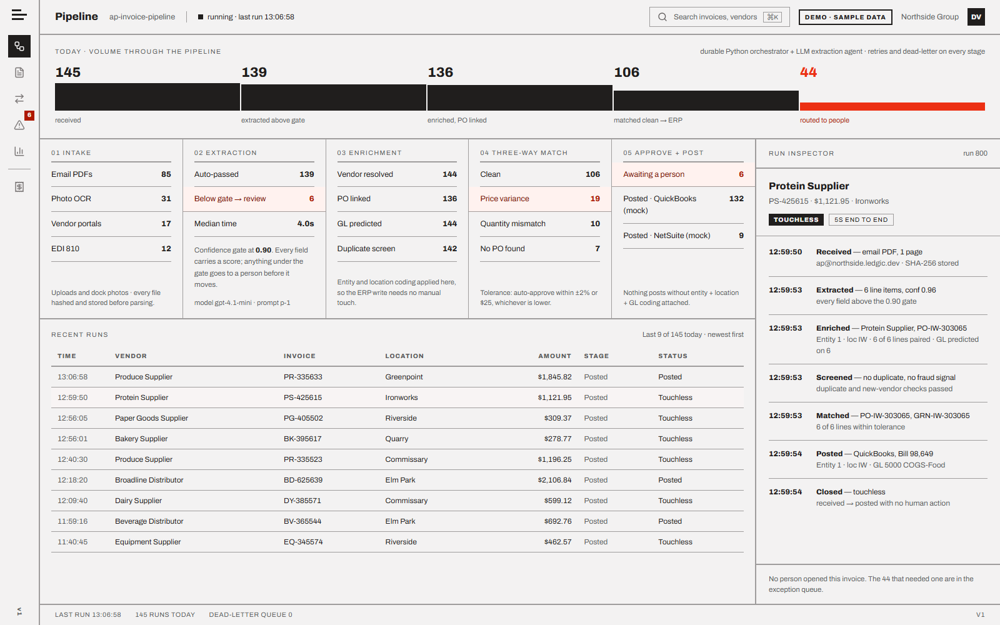
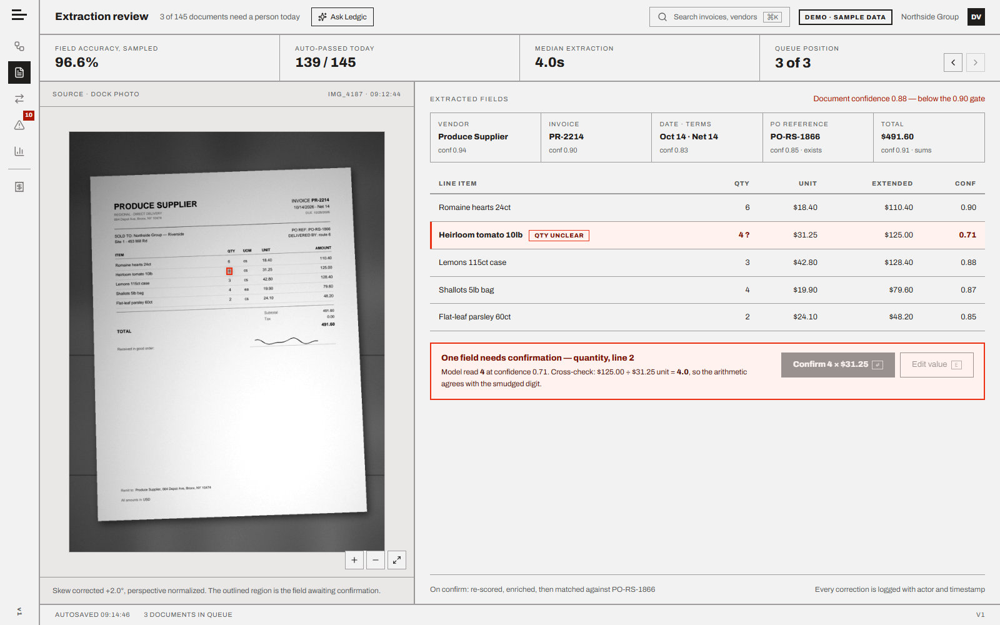
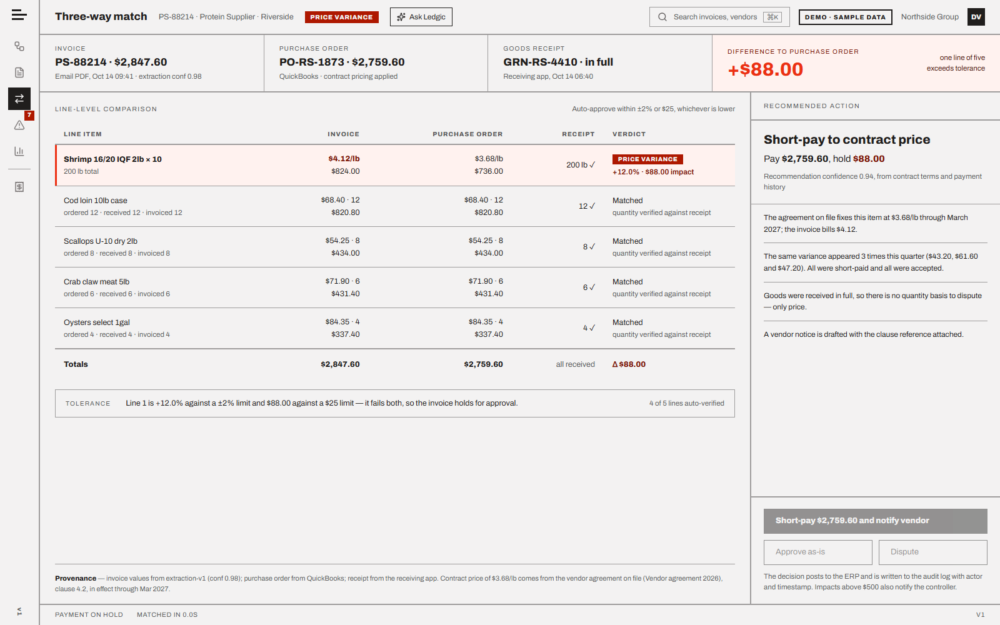
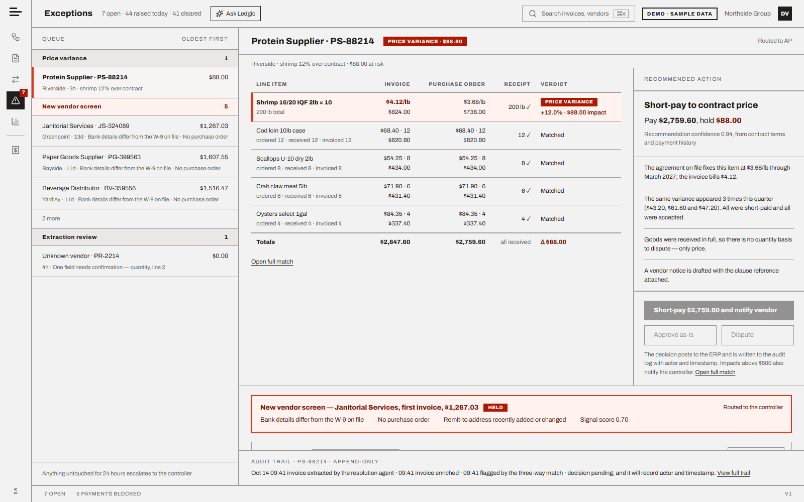
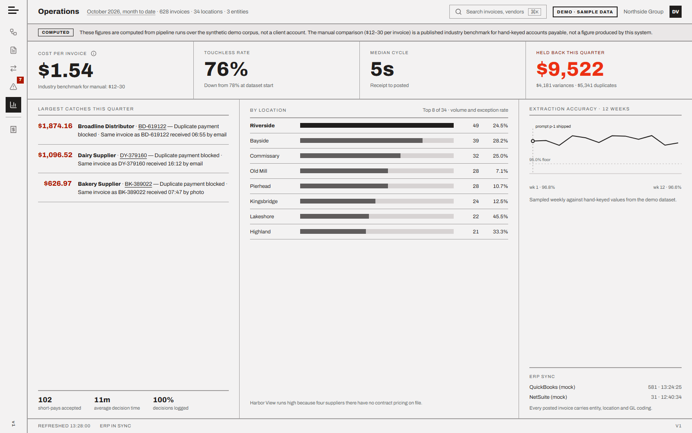
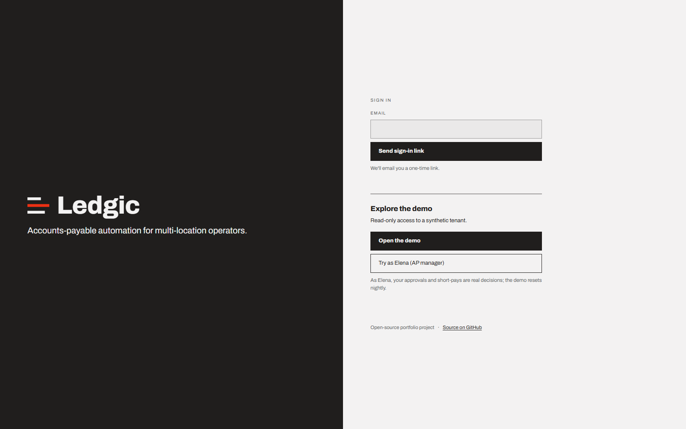
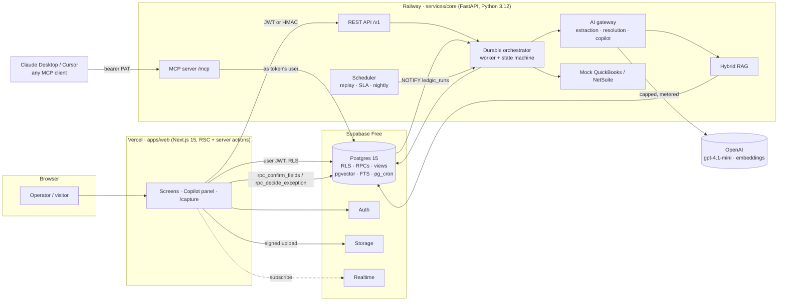
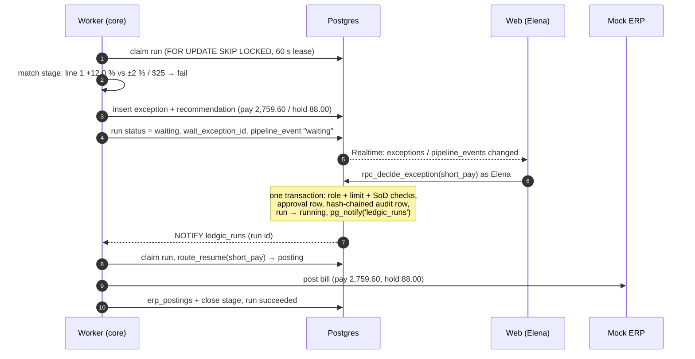

# Ledgic

**Open-source accounts-payable automation: AI extraction, three-way matching, tool-using agents, RAG and an MCP server, built on a durable Python orchestrator with every KPI computed in SQL.**

Ledgic takes supplier invoices (PDFs and phone photos from the receiving dock), reads them with a vision
model that reports a confidence for every field, matches each line against the purchase order, the goods
receipt and the contract price, and either posts the bill to the ERP with no human touch or parks it in an
exception queue with the evidence and a recommendation attached. Every decision lands in a hash-chained,
append-only audit log. It runs on a clearly labelled synthetic tenant (Northside Restaurant Group: 3 legal
entities, 34 locations), it is live, and every number on every screen is a SQL view over real pipeline runs.

[](https://github.com/alihdrndm/ledgic/actions/workflows/ci.yml)
[](LICENSE)


---

## Live demo

| | |
|---|---|
| **Web app** | **https://ledgic-pearl.vercel.app** |
| Core API | https://core-production-f996.up.railway.app ([`/health`](https://core-production-f996.up.railway.app/health)) |
| MCP endpoint | `https://core-production-f996.up.railway.app/mcp` (bearer token, see [MCP](#use-it-from-claude-desktop--cursor-via-mcp)) |

On the login page, pick one:

- **Open the demo**: signs you in as the read-only *Demo Viewer*. You can see every screen, open any
  invoice, verify the audit chain and ask the copilot questions. Action buttons are disabled.
- **Try as Elena (AP manager)**: signs you in as Elena Marsh, who can confirm extracted fields and decide
  exceptions up to the $5,000 manager limit. Short-pay PS-88214 and watch the paused run resume and post.

No email is needed. The demo replays about 180 documents a day (heroes at fixed times, America/New_York)
and resets nightly.

## Screens

Captured from the live demo (`docs/screenshots/`). Design targets from the handoff are in
`docs/handoff/design/screens/`.

| Pipeline | Extraction review |
|---|---|
|  |  |
| **Three-way match** | **Exceptions** |
|  |  |
| **Operations** | **Login** |
|  |  |

## What it does

1. **Intake.** Upload or mobile `/capture` (dock photos). Files are SHA-256 hashed; a re-delivered file
   never creates a second run.
2. **AI extraction.** A vision agent returns a strict schema: header fields and line items, each with a
   confidence and a bounding box. A confidence gate (document ≥ 0.90, every field ≥ 0.75) decides whether
   a person must look.
3. **Enrichment.** Vendor resolution (fuzzy + aliases), PO linking, GL coding per line (kNN over coded
   history), entity and location assignment.
4. **Duplicate and fraud screening.** Invoice-number trigrams, amount/date, line overlap and perceptual
   image hash for duplicates; bank details vs W-9, vendor age, missing PO and new remit address for fraud.
5. **Three-way match.** Each line vs PO vs goods receipt vs **contract price**, with tolerance
   *± 2 % or $25, whichever is lower*. All money math is `Decimal`.
6. **Touchless post or human exception.** Clean invoices post to a (mocked) QuickBooks / NetSuite with
   entity, location and GL coding. Everything else becomes an exception with a deterministic
   recommendation, and the decision is **role-gated in the database** (clerk, AP manager up to $5,000,
   controller above that and for fraud holds; segregation of duties).
7. **Audit.** Every field confirmation, decision and system action is written to a per-org SHA-256 hash
   chain that the UI (and the MCP server) can verify on demand.

## Why it's interesting

**Agents**
- **Extraction agent**: `gpt-4.1-mini` vision via the OpenAI Agents SDK into a strict pydantic schema
  (`contracts/extraction.schema.json`) with per-field confidence and bbox; calibrated and gated by
  deterministic code.
- **Resolution agent**: a tool-using agent (contract-clause RAG, vendor history, PO/GRN lookup, the
  deterministic recommendation) drafts vendor notices and internal explanations with citations. A
  **money-figure guard** extracts every dollar amount from the draft and rejects it unless each one equals
  a figure from the deterministic facts. The model reads; it never decides.
- **Ask Ledgic copilot**: a RAG agent with read-only tools (≤ 6 tool calls, ≤ 1.5k output tokens) that
  answers with numbered, clause-level citations and streams over SSE.
- **Durable orchestrator**: no workflow engine. A Python state machine with state in Postgres. Workers claim
  runs with `FOR UPDATE SKIP LOCKED` and a lease, and each stage returns advance / park / retry / finish /
  fail. Retries back off over 10 s to 300 s, then the run goes to a dead letter. A human-in-the-loop
  decision **parks** the run, and the decision RPC **resumes** it in the same transaction with
  `pg_notify` (Postgres `LISTEN/NOTIFY`).

**RAG**
- pgvector (`text-embedding-3-small` @ 512 dims) and Postgres full-text search fused with **reciprocal-rank
  fusion** (k = 60) in one SQL function (`kb_search`), then a BM25 rerank over the candidate pool.
- Heading-aware chunking keeps **clause references** (`## 4.2 Pricing` → `4.2`), so answers cite
  *Protein Supplier agreement §4.2* rather than "the contract".
- **Budget-aware degradation**: cached answer → live agent → retrieval-only answer built from verbatim
  quotes when the daily budget is spent, so the copilot never fails and never invents.

**MCP**
- 8 tools (`list_exceptions`, `get_invoice`, `explain_match`, `search_contracts`, `ask_ledgic`, `get_kpis`,
  `verify_audit_chain`, `decide_exception`), 2 resources, 2 prompts. Streamable HTTP at `/mcp` and a
  `ledgic-mcp` stdio entry point.
- Permissions are **enforced by the database**: every tool runs as the token's user, so a read-only demo
  token that somehow reached `decide_exception` would still be refused by `rpc_decide_exception`.

**Honest metrics**
- No hard-coded numbers. Every KPI on Operations is a SQL view or materialized view (`v_ops_period`,
  `v_location_period`, `v_eval_weekly`, …). Assumptions such as the loaded hourly rate are shown, and the
  external benchmark is labelled as external.

**Security**
- Row-level security on every table, `security_invoker` views, `security definer` RPCs with a fixed
  `search_path`, segregation of duties (you can't approve an invoice whose amounts you edited, or release
  a vendor you created), an append-only hash-chained audit log guarded by triggers, and **113 pgTAP tests**.

**Cost engineering**
- **$0 infrastructure**: Supabase Free, Vercel Hobby, and one Railway service on the existing Hobby plan.
- **$0.50/day hard LLM cap**: every model call reserves its estimated cost atomically in Postgres
  (`llm_budget_reserve`) and settles the actual cost from token usage. The cap fails closed. Replay uses
  recorded outputs ($0). Visitors can bring their own key (`X-OpenAI-Key`, used for that request only, never stored).

## Architecture



Human-in-the-loop park and resume:



Deeper write-ups: [docs/ARCHITECTURE.md](docs/ARCHITECTURE.md) · [docs/AGENTS_RAG.md](docs/AGENTS_RAG.md) ·
[docs/MCP.md](docs/MCP.md) · [docs/RUNBOOK.md](docs/RUNBOOK.md).

## Tech stack

| Layer | Choice |
|---|---|
| Web | Next.js 15.5 (App Router, React Server Components, server actions), React 19, TypeScript 5.9, `@supabase/ssr`, `decimal.js`, `lucide-react`, Playwright + axe |
| Core | Python 3.12, FastAPI, pydantic 2, psycopg 3 (async pool), APScheduler 3, rapidfuzz, scipy, Pillow + imagehash, pypdfium2, reportlab, uv |
| AI | OpenAI `gpt-4.1-mini` (vision, structured outputs) via the OpenAI Agents SDK, `text-embedding-3-small` @ 512 dims |
| MCP | Official `mcp` Python SDK: streamable HTTP + stdio |
| Data | Supabase: Postgres 15, pgvector, pg_trgm, pgcrypto, pg_cron, Auth, Storage, Realtime |
| Tests | pytest + hypothesis, pgTAP, Playwright |
| Hosting | Vercel Hobby (web), Railway (core, Dockerfile), Supabase Free |
| CI | GitHub Actions: ruff, pytest, tsc, ESLint, token lint, `supabase test db`, gitleaks |

## Repository layout

```
ledgic/
├── apps/web/                 Next.js operator console
│   ├── app/                  login, capture, o/[org]/{pipeline,extraction,match,exceptions,operations,invoices}, api/
│   ├── components/           ui primitives, shell (rail/top bar/status bar), per-screen components, copilot
│   └── lib/                  queries, server actions, core client (JWT / HMAC), realtime, auth helpers
├── services/core/            FastAPI core (one process: API + worker + scheduler + MCP)
│   └── app/
│       ├── orchestrator/     durable state machine, stage handlers, resume routing, worker
│       ├── domain/           pure Decimal math: tolerance, gate, duplicates, fraud, pairing, recommend, GL kNN
│       ├── ai/               gateway (modes, budget, BYOK), extraction / resolution / copilot agents, tools, rag/
│       ├── mcp/              MCP tools, token auth, HTTP + stdio transports, token CLI
│       ├── api/              REST routes, admin (HMAC), auth, response envelope
│       ├── scheduler/        leader-elected jobs: replay, SLA escalation, nightly reset
│       ├── posting/          mock QuickBooks / NetSuite adapters
│       ├── repo/ db/         SQL access, connection pool, act-as-user
│       └── demo/             seed, synthetic corpus generator, replay planner, backfill
├── supabase/
│   ├── migrations/           schema, RLS, RPCs, KPI views, realtime
│   └── tests/                pgTAP: RLS isolation, audit log, decision RPCs, KPI views
├── packages/db-types/        generated TypeScript types for the database
├── tools/corpus/             corpus CLI, knowledge base (kb/), recorded hero fixtures
├── contracts/                frozen interfaces: core API, RPCs, views, extraction schema, hero fixtures
└── docs/                     ARCHITECTURE, AGENTS_RAG, MCP, RUNBOOK, DECISIONS, handoff/ (original spec)
```

## Run locally

**Prerequisites:** Node 22+, pnpm 9, Python 3.12 + [uv](https://docs.astral.sh/uv/), Docker (for local Supabase).

```bash
git clone https://github.com/alihdrndm/ledgic && cd ledgic
pnpm install

# 1. Database: Postgres, Auth, Storage, Realtime in Docker, migrations applied
npx supabase start
cp .env.example .env            # fill the keys printed by `supabase start`, plus demo passwords of your choice
cp .env apps/web/.env.local     # the web app reads its own env file

# 2. Core: dependencies, demo tenant, knowledge base, a week of history
cd services/core
uv sync
uv run python -m app.demo.seed            # Northside org, users, vendors, contracts, POs, eval history
uv run python -m app.ai.seed_kb           # index tools/corpus/kb + precompute copilot answers
uv run python -m app.demo.backfill --days 7 --today
uv run uvicorn app.main:app --port 8000   # API + worker + scheduler + /mcp

# 3. Web (new terminal, repo root)
pnpm dev                                   # http://localhost:3000
```

`LLM_MODE=fixture` (the default) never calls OpenAI: extraction uses recorded or simulated outputs,
embeddings are deterministic, and the copilot answers retrieval-only. Set `LLM_MODE=live` and
`OPENAI_API_KEY` to use real models under the daily cap.

## Use it from Claude Desktop / Cursor via MCP

The public demo publishes a **read-only** token for the Demo Viewer (below the config snippets).

Cursor (`.cursor/mcp.json`):

```json
{
  "mcpServers": {
    "ledgic": {
      "url": "https://core-production-f996.up.railway.app/mcp",
      "headers": { "Authorization": "Bearer <your token>" }
    }
  }
}
```

Claude Desktop (bridging the bearer header with `mcp-remote`):

```json
{
  "mcpServers": {
    "ledgic": {
      "command": "npx",
      "args": ["-y", "mcp-remote", "https://core-production-f996.up.railway.app/mcp",
               "--header", "Authorization:Bearer ${LEDGIC_TOKEN}"],
      "env": { "LEDGIC_TOKEN": "<your token>" }
    }
  }
}
```

**Token.** The hosted endpoint needs a bearer token, and none is published here: a credential committed to
a public repo gets scraped and abused, even a read-only one. Two ways to try it:

- **Locally (recommended):** run the stack (see [Run locally](#run-locally)), then mint a read-only token
  against your own database:
  `cd services/core && uv run python -m app.mcp.tokens create --user <viewer uuid> --org <org uuid> --scopes read --name me`
  and point the config above at `http://localhost:8000/mcp`, or use the stdio server (`ledgic-mcp`).
- **Hosted demo:** ask the maintainer for a short-lived read-only token.

Then ask *"Why is PS-88214 held?"*. The client calls `explain_match` and `search_contracts` and cites clause 4.2.
`decide_exception` is refused for the demo token. Full setup, local stdio and the security model:
[docs/MCP.md](docs/MCP.md).

## Testing

| Suite | Count | Command |
|---|---|---|
| Core unit tests (domain math incl. hypothesis properties, orchestrator, AI agents and guards, RAG, MCP, API, corpus) | **285** | `cd services/core && uv run pytest` |
| Core integration scenarios against local Supabase (touchless, smudge → resume, short-pay, duplicate merge, fraud release + SoD, posting failure → retry, re-delivery no-op) | **8** | `uv run pytest -m integration` |
| Database (pgTAP): RLS isolation, audit immutability and chain, decision RPC limits + SoD, KPI views | **113** | `npx supabase test db` |
| Web: types, lint, design-token lint | | `pnpm typecheck && pnpm lint && pnpm --filter @ledgic/web check:tokens` |
| Web smoke + accessibility (Playwright + axe at 1280 / 1600) | in progress | `pnpm test:e2e` (config in `apps/web/playwright.config.ts`) |

Hero numbers are asserted exactly: 736.00 / 824.00 / 88.00 / 14.72 / +12.0 % / 2,759.60 / 0.94.

## Hero scenarios

Five cases are replayed every demo day at fixed times. Their numbers are pinned in `contracts/fixtures.json`.

| Invoice | Vendor | What happens | Outcome |
|---|---|---|---|
| **PS-88214** | Protein Supplier | Shrimp billed $4.12/lb vs contract $3.68/lb (clause 4.2): $824.00 vs $736.00, +12.0 % against ± 2 % / $25 | Price variance. Recommendation (0.94): **short-pay $2,759.60, hold $88.00**, notify vendor |
| **PR-2214** | Produce Supplier | Dock photo with a smudged quantity: field confidence 0.71, document 0.88 | **Extraction review**. A clerk confirms the value, the run resumes |
| **PR-2201** | Produce Supplier | Same invoice by email at 08:02 and as a dock photo at 16:44 (similarity ≥ 0.90) | **Duplicate**, payment blocked. Merge so the copy can never be paid |
| **NV-0001** | Unlisted Supplier | Bank details ≠ W-9, vendor 4 days old, no PO, new remit address (score 0.90) | **Fraud hold**, controller only, and never by the vendor's creator |
| **BD-104882** | Broadline Distributor | Clean invoice, every line within tolerance | **Touchless**: posted to the ERP with zero human actions |

## Design decisions

Ledgic started from a handoff spec written for a paid AWS + n8n + hosted-LLM + Textract stack. The
departures (code instead of n8n, OpenAI with a hard daily cap, mocked ERPs, free tiers, an added resolution
agent, copilot and MCP server) and the reasons for each are in [docs/DECISIONS.md](docs/DECISIONS.md).
The original spec is kept in [docs/handoff/](docs/handoff/).

## Security

Please report vulnerabilities privately through GitHub's
[Report a vulnerability](https://github.com/alihdrndm/ledgic/security/advisories/new) form, never in a public
issue. Scope, response targets and safe harbor are in [SECURITY.md](SECURITY.md).

## Contributing

Issues and pull requests are welcome. See [CONTRIBUTING.md](CONTRIBUTING.md) for setup, checks and the
secrets policy, [SUPPORT.md](SUPPORT.md) for questions, and the [Code of Conduct](CODE_OF_CONDUCT.md).

## License

[MIT](LICENSE) © Ali Haider Nadeem

Built by **Ali Haider Nadeem** ([@alihdrndm](https://github.com/alihdrndm)). Northside Restaurant Group and
its vendors are fictional. All demo data is synthetic.
